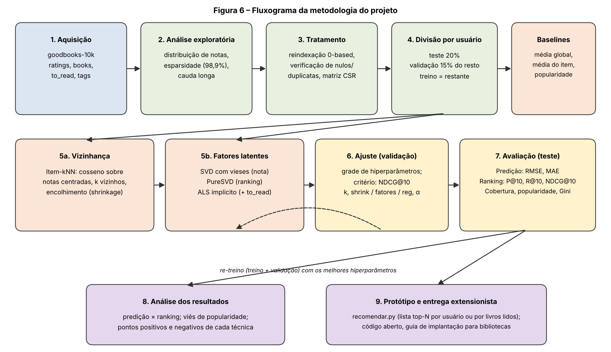
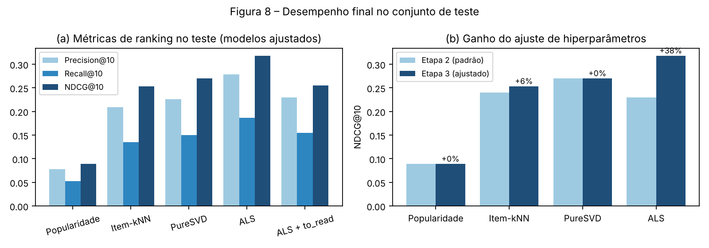

# Projeto Aplicado III – Sistema de Recomendação de Livros

**Universidade Presbiteriana Mackenzie – Curso de Ciência de Dados**
**Aluno:** Enzo Enrico Braga Cavalcante (RA 10744145) · **Local/Ano:** Guarulhos – 2026

> 🎬 **Vídeo de apresentação (6 min):** `https://youtu.be/nXz4BzQV8xU`
> 📄 **Documentação final:** [docs/Projeto_Aplicado_III_Documento_Final.pdf](docs/Projeto_Aplicado_III_Documento_Final.pdf)
> 📚 **Guia para bibliotecas:** [docs/GUIA_IMPLANTACAO_BIBLIOTECAS.md](docs/GUIA_IMPLANTACAO_BIBLIOTECAS.md)

## Sobre o projeto

Desenvolvimento e avaliação de um **sistema de recomendação de livros baseado em filtragem colaborativa**, entregue como ferramenta aberta para bibliotecas públicas, escolares e comunitárias apoiarem o incentivo à leitura (ODS 4, 9 e 10). Continuação do [Projeto Aplicado II](https://github.com/Enzo-Enrico/Projeto-Aplicado-II-Analise-Sentimento).

## Dataset

[goodbooks-10k](https://github.com/zygmuntz/goodbooks-10k) (Zajac, 2017): 5.976.479 avaliações (1–5) de 53.424 usuários sobre 10.000 livros do Goodreads, mais metadados, marcações "quero ler" e tags. Esparsidade de 98,9%; 20% dos livros concentram 67,5% das avaliações.

## Metodologia



- Divisão por usuário: 20% teste, 15% do restante validação, restante treino (semente 42).
- Modelos: popularidade, Item-kNN (cosseno + shrinkage), SVD com vieses, PureSVD, ALS implícito (± "quero ler").
- Hiperparâmetros escolhidos na validação por NDCG@10; teste usado uma única vez.
- Avaliação separada: **erro de predição** (RMSE, MAE) × **qualidade da lista** (Precision@10, Recall@10, NDCG@10, ranking exaustivo) + cobertura, popularidade média e Gini.

## Resultados finais (conjunto de teste)

| Modelo | Hiperparâmetros | P@10 | R@10 | NDCG@10 | Cobertura | Pop. média |
|---|---|---|---|---|---|---|
| Popularidade | – | 0,078 | 0,052 | 0,089 | 0,4% | 13.496 |
| Item-kNN | k=20, β=50 | 0,209 | 0,135 | 0,253 | **73,2%** | 3.880 |
| PureSVD | 50 fatores | 0,226 | 0,150 | 0,270 | 9,7% | 5.942 |
| **ALS implícito** | 256 fatores, λ=0,01, α=5 | **0,278** | **0,187** | **0,318** | 39,2% | **3.143** |
| ALS + to_read | 256 fatores, α=10 | 0,230 | 0,154 | 0,255 | 47,3% | 3.630 |

Na prova de conceito, o SVD com vieses teve o **menor RMSE (0,828)** e a **pior lista (NDCG@10 = 0,010)**. O ajuste de hiperparâmetros deu **+38%** de NDCG@10 ao ALS.



## Protótipo

```bash
cd src
python recomendar.py --usuario 4765                                   # usuário da base
python recomendar.py --livros "Harry Potter" "Hobbit" "Percy Jackson" # leitor novo (folding-in)
python recomendar.py --livros "Sapiens" "Freakonomics" --n 10 --csv lista.csv
```

## Estrutura do repositório

```
├── data/download.py              # baixa o goodbooks-10k (CSVs ignorados pelo git)
├── src/
│   ├── 01_eda.py                 # análise exploratória (figuras 1–4)
│   ├── 02_poc_modelos.py         # prova de conceito (Etapa 2)
│   ├── 03_ajuste_modelos.py      # validação + grade de hiperparâmetros + teste (Etapa 3)
│   ├── 04_refino_als.py          # extensão da grade do ALS, modelo final, exemplos
│   └── recomendar.py             # protótipo (CLI)
├── figures/                      # todas as figuras do documento
├── docs/
│   ├── Projeto_Aplicado_III_Documento_Final.pdf
│   ├── Projeto_Aplicado_III_Etapa1.pdf · Etapa2.pdf · Etapa2_Prova_de_Conceito.pdf
│   ├── GUIA_IMPLANTACAO_BIBLIOTECAS.md
│   ├── ROTEIRO_VIDEO.md
│   ├── (modelo_als.npz é gerado localmente por recomendar.py; não versionado)
│   ├── ajuste_validacao*.csv · resultados_finais.csv · tabela_final_consolidada.csv
│   └── sensibilidade_k_als.csv · exemplos_finais.json · melhores_hiperparametros.json
├── requirements.txt
└── README.md
```

## Reprodução completa

```bash
git clone https://github.com/Enzo-Enrico/Projeto-Aplicado-III-Sistema-Recomendacao.git
cd Projeto-Aplicado-III-Sistema-Recomendacao
pip install -r requirements.txt
python data/download.py
cd src
python 01_eda.py            # ~1 min
python 02_poc_modelos.py    # ~3 min
python 03_ajuste_modelos.py # ~20 min
python 04_refino_als.py     # ~7 min
```

Testado em Python 3.13, 2 núcleos, 4 GB de RAM.

## Cronograma

| Etapa | Entrega | Status |
|---|---|---|
| 1 | Capa, Sumário, Introdução | ✅ |
| 2 | EDA, prova de conceito, Referencial Teórico | ✅ |
| 3 | Ajuste do pipeline, reavaliação, Metodologia | ✅ |
| 4 | Resultados, Conclusão, Resumo, protótipo, guia, vídeo de apresentação | ✅ |

## Referências principais

Hu, Koren e Volinsky (2008); Cremonesi, Koren e Turrin (2010); Sarwar et al. (2001); Ferrari Dacrema et al. (2019, 2021); Rendle et al. (2020); Krichene e Rendle (2020); Ge, Delgado-Battenfeld e Jannach (2010); Abdollahpouri, Burke e Mobasher (2017). Lista completa no documento final.
